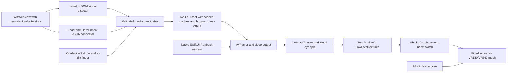

# Technical architecture

## Reclined viewing (0.12.0)

**Recenter** starts a three-second countdown. Look where the video should face; the renderer captures the full head orientation, including upward pitch and side tilt. It keeps that orientation fixed while you look around naturally. **Position → Video tilt** adjusts the video up/down by up to 90 degrees relative to the captured centre without moving the controls. **Reset tilt** removes that adjustment; **Reset upright** levels the video with the room and keeps the controls facing you. Recenter clears manual tilt. Each new immersive session starts centred on the current head pose; quality changes preserve the current position.

Playback controls are now a glass-backed RealityView attachment, rather than a separate system window. Position, Format and Quality expand within that surface because the former window popovers do not reliably present from attachments. Recenter positions the actual visible controls below the captured viewing direction. Return to page opens the browser and waits for its view to appear before dismissing immersion. System dismissal also restores the browser. The single WKWebView and its live webpage remain in AppModel. No head pose or viewing-angle history is saved. Physical Vision Pro gaze/pinch and reclining comfort remain unverified.

## Save queue coordinator (0.9.1)

AppModel owns a bounded FIFO of up to 20 waiting save requests. The browser and finder both use enqueueSave; the active native MP4/HLS transfer APIs retain their single-transfer validation rules. A short-lived main-actor observer waits until both models are idle, including native HLS recovery, then starts the next request. Success, failure and cancellation advance the queue; a paused HLS job blocks it until resumed or cancelled. Pending entries can be removed, exact active/pending source duplicates are rejected, and a failed MP4 is disclosed while later entries proceed. Signed source URLs, browser identity and scoped cookies are captured only in memory. The queue is not persisted or resumed after termination. Diagnostic queue contexts are parent-linked to actual transport attempts and expose neither URLs nor titles.

## 0.9.0 resource tracing and foreground save recovery

The current implementation adds bounded checks of exact published HLS resources after selected native save failures. Reports correlate playlist/dependency/segment role, sequence, HTTP status and a per-session resource ID without exposing private URLs or credentials. Foreground range/header checks are labelled separately from native background traffic; a successful check does not prove the background request was equivalent.

A controlled simulator fixture proved that Apple's background HLS service can send a different User-Agent from the actual working WebKit player despite public request options. Supported clear on-demand MPEG-TS can now recover as an MP4 through foreground URLSession transport with the actual browser identity and normally scoped cookies. A local-only LGPL FFmpeg framework remuxes without re-encoding; native playback and duration are checked before the saved file is committed. See `Docs/MEDIA_RUNTIME.md` for supported formats, limits and rebuilding. Other HLS packaging forms continue to need engineering; this is not universal HLS downloading.

Automatic stereo analysis now handles larger, locally varying disparity and partial occlusion using bounded regional comparison and three-frame agreement. It keeps metadata, explicit mono and manual choices authoritative and rejects unrelated/ambiguous images. No decoded image samples are stored in diagnostics.

The native background HTTP 404 resource remains unidentified. A new user-supplied 0.9.0 report on 26 October confirms two foreground MP4 saves completed and local VR playback decoded1440×720. Passive inspection subsequently found all three completed copies in the local catalogue. No new agent-controlled remote-site access was performed. This verifies those fallback attempts, not universal website support; automatic format selection for the second live stream remains unverified because the final snapshot is manual.

## Version 0.6.0 — recoverable libraries and HLS offline playback

MP4 import uses a cancellable coordinated chunked copy from Files, a scoped access lifetime and native playability/protection validation. It keeps the original intact. Export uses the system share sheet. Catalogue repair scans bounded UUID-named regular files without following links, preserves valid names/hints, and keeps a backup of a bounded damaged index.

`HLSOfflineLibrary` uses `AVAssetDownloadURLSession` with a stable background identifier, the public configuration API and an application-delegate completion handler. Reconnection finishes before new task creation; task UUIDs reconnect to a bounded local journal. Pause/resume/cancel operate on system tasks. Preparation rejects protected/live/unplayable assets; completion verifies `assetCache.isPlayableOffline`, bounds the package and retains only its relative local reference. Packages remain in Apple’s supplied location. Streaming never silently initiates offline saving. Apple may persist transport request information privately; the app’s journal does not persist source URLs, cookies or resume blobs. Download quality is system-selected. Suspended/background storage usage is not a strict 8 GiB quota; completion rejects packages beyond that bound. Force-quit, expired access and eviction still require recovery.

The HLS package resolver accepts only the observed managed-assets namespace within this app’s Library, checks each existing path component for links and never accepts arbitrary pasted local URLs. A future Apple placement change fails clearly rather than widening ownership. Local package playback skips network quality inspection and confirms offline availability before native preparation.

`BrowserPreferences` separates bookmarks from session restoration. Home retains no reopening address; Last website keeps only the origin; Last page deliberately retains the complete page address. Selecting less retention removes already-stored detail immediately. Bookmark lists are bounded/validated, and damaged data is preserved unless a confirmed reset can back it up. Preferences/bookmarks may be included in system backups; downloaded media is excluded.

The simulator harness adds shared bookmark/settings actions and a configurable 60–1,800 second playback soak. It measures actual received frames and simulator process resident memory while changing transport, format and quality. This cannot measure physical GPU peaks, thermals or battery.

## Version 0.5.0 — historical implementation

`DownloadModel` owns one explicit foreground MP4 transfer, progress, cancellation and the local catalogue. `MP4DownloadTransfer` uses an isolated ephemeral URLSession cookie jar, matching WebKit cookies and the actual browser User-Agent. Redirects are restricted to the same HTTPS origin; cross-origin redirects fail rather than forwarding request context. Only complete HTTP 200 MP4/octet-stream responses, bounded to 8 GiB, with an ftyp signature and a playable unprotected local AVURLAsset are committed. Progress updates are throttled; a 256 MiB free-space reserve is checked during transfer. This is a safety bound, not a guaranteed disk reservation. Transfers have 60-second request/2-hour resource timeouts; local validation has a 15-second cancellation deadline.

`OfflineVideoStore` atomically stores a bounded catalogue of UUID, visible name, size, date and format hint. It never stores remote URLs, cookies, headers or resume data. Videos and their directory are excluded from backups. Staging files are removed after completion/failure/cancellation and on next startup. A corrupt catalogue is reported rather than overwritten. Owned playback accepts only a regular, non-symlink UUID-named file of the catalogue’s expected size. Pasted/file URLs remain rejected by the normal network candidate pipeline. Offline preparation uses the same AVPlayer/renderer, with retained format hints and bounded local spherical metadata inspection. Quality switching never reopens a network source for a saved video.

At 0.5.0, downloads exposed progress, cancel, storage use, offline play and confirmed deletion. HLS offline saving, background transfer, pause/resume and import/export were still pending. The embedded yt-dlp resolver remains metadata-only. Native HLS saving would use Apple’s AVAssetDownloadURLSession and requires a separate lifecycle/storage design; saving an M3U8 alone is insufficient. [Apple download-session documentation](https://developer.apple.com/documentation/avfoundation/avassetdownloadurlsession).

Browser chrome prioritises navigation and Watch in VR. Video tools groups scanning, source discovery, MP4 download and diagnostics. Format settings expose Auto before and during playback. Browser options provide help and confirmed website-data clearing; existing downloaded files are retained. Direct-link and library forms remain available.

`PlaybackAudioEvents` observes system interruption, output-disconnection and media-service-reset notifications. Typed events cross to the main actor. Interruption begins pause playback; resumption requires both system permission and prior playback intent. An explicit pause or stopped/replaced session prevents late automatic resumption. Headphone/output disconnection pauses, and a service reset releases the player with recovery guidance. Activation/deactivation remains serialized with generation ownership. Tests inject the real notification names; physical Bluetooth routing, interruptions and headset removal still require device acceptance. See [Apple route-change guidance](https://developer.apple.com/documentation/avfaudio/responding-to-audio-route-changes).

The bundled `PrivacyInfo.xcprivacy` declares native app settings, free-space checks that visibly stop a download, app-container file metadata, and local elapsed-time measurement. The reasons follow [Apple’s required-reason guidance](https://developer.apple.com/documentation/technotes/tn3183-adding-required-reason-api-entries-to-your-privacy-manifest): CA92.1, E174.1, C617.1 and 35F9.1. There is no native analytics/tracking collection. Websites manage their own requests and storage; a complete third-party-runtime/distribution review remains a release gate.

## Historical version 0.4.1 metadata and controls correction

A public NASA MP4 reproduced a missing automatic-projection result: decoded video reached 2,160×1,080, while CoreMedia's translated projection extensions were absent. Its video track instead contained the legacy spherical UUID defined by the [Spherical Video RFC](https://github.com/google/spatial-media/blob/master/docs/spherical-video-rfc.md). The app now optionally inspects a bounded 256 KiB MP4 prefix after native readiness. It requires an honored HTTP 206 byte range, declines redirects/ignored ranges/oversized responses, uses scoped cookies and the actual browser request identifier, and in 0.5.0 allows up to eight seconds per attempt, with one retry only for a transient timeout/lost/offline connection. The total optional inspection is bounded to two attempts. It never blocks ordinary playback or writes a media file.

The parser accepts only complete fast-start movie/video-track metadata, the exact spherical UUID, namespace-qualified stitched equirectangular fields, and supported packing. It rejects DTD/entities, duplicates, malformed sizes, oversized XML, conflicting tracks and unsupported crops. Full panoramas and centered horizontal 180° crops are supported; arbitrary crops, non-equirectangular projections, metadata beyond the inspected prefix and unrecognized V2 boxes still require another supported signal or a manual choice. Recognized native projection fields take precedence. A manual choice wins over late inspection; metadata is retained for returning to Auto.

Finder results retain the exact page address resolved, only in memory. On handoff, the app can preserve the current page's VR title cue only when that address matches the open page, including its query identifiers. An element's explicit format metadata transfers only when a single same-page video group agrees. Different pages, changed video IDs, unrelated frames and ambiguous element metadata do not inherit packing. The media source itself is never replaced by this context step. Core tests cover those boundaries.

Streaming quality now uses a native popover with Highest/Adaptive descriptions and the active selection. Simulator-only hooks invoke the same SwiftUI actions as the visible popovers and record mounting/dismissal; they accept only the existing local fixture configuration. Physical-device binaries exclude those hooks. The new `controls` scene covers format changes, returning to Auto, quality changes preserving a paused position, transport and real exit. The `quality4k` scene selects a native-resolution original 3,840×1,920 calibration rendition from a low-first master and verifies actual decoded frames with automatic VR180/SBS. The fixed public NASA finder scene verifies automatic VR360/mono.

## Version 0.4.0 quality and format selection

Highest is the default streaming preference. For a published HLS master, a bounded HTTPS inspection selects the largest supported SDR H.264/HEVC rendition with muxed audio. It follows the exact published child URI, including its query; it does not append parent tokens, rewrite manifests, inject Referer/Origin, follow inspection redirects or download whole videos. Inspection accepts at most 512 KiB, 8,192 lines and 64 variants, with cancellation and the existing preparation deadline. A child with external audio/subtitles/video groups, session keys, variable definitions, unknown codecs, HDR or dimensions above 8,192 is not pinned. In those cases the original master remains adaptive and the controls say so. A direct MP4 or single-rendition playlist cannot expose higher qualities that the website has not supplied; Find streams can offer separately published alternatives.

The inspector uses scoped browser cookies and the actual browser User-Agent. When a master issues normal Set-Cookie headers, matching response cookies accompany the selected child; they are not written to browser/global storage. A browser cookie-provider callback rechecks the selected child's URL. AVPlayer's bitrate/resolution ceilings are unlimited, but those preferences alone do not force a rendition. The selected rendition's size and actual decoded frame size are reported separately. Highest uses more bandwidth and can buffer on a slow connection; Adaptive is available in the playback menu. Switching quality retains the playback position and paused/playing state, and leaves the existing renderer alive while preparing the replacement.

Automatic format detection is enabled in the app. It reads explicit DOM projection/stereo attributes, recognized filename/title labels, and public CoreMedia projection/packing extensions when available. Explicit metadata takes precedence per component, so a projection-only hint does not discard a separate layout label. Version 0.6.2 also analyses unlabelled streams: three agreeing textured image-half matches can identify side-by-side or top/bottom packing. A bounded 128 × 64 luma sample averages 16 decoded pixels per output pixel; global and regional correlations allow small horizontal disparities that vary with scene depth. Low-texture, ambiguous and inconsistent matches are rejected. Per-eye proportions then suggest equirectangular 180/360 only when projection is not already identified. A bare 2:1 frame never establishes VR. Image-based projection is a heuristic: a flat stereo picture with the same packing/proportions can be misclassified, and fisheye/mesh mappings cannot be established this way. Pixel samples stay in memory and are never logged. Explicit mono/packing metadata and manual settings remain authoritative. Unidentified sources remain Screen + Single image. Manual projection/layout choices disable inference until Auto is re-enabled. Fisheye, mesh and multiview routing remain separate unsupported formats.

The Metal renderer accepts up to 8,192 pixels per decoded dimension and now retains up to 4,096 pixels per eye dimension (previously 2,048). It still scales larger eye images to that bounded allocation. Sustained 8K decoding, memory/thermal behavior and physical stereo depth require headset measurements. The compact native controls show actual decoded size, quality preference, timeline and transport; a format popover contains Auto, projection, packing, eye swap and vertical flip.

## Data flow

## Responsibilities

`OnDeviceExtractor` adds a third candidate source using a bundled visionOS CPython runtime and pure Python yt-dlp. A serial background queue and GIL-scoped Objective-C bridge return a bounded, redacted JSON payload; the Swift parser accepts only supported HTTPS media types. Public extraction does not inherit browser login. Downloads, desktop helpers, external JavaScript runtimes, plugins and remote code components are disabled. Cancellation discards late results; navigation and sheet dismissal clear retained candidates. Unsupported projection, protection, separate audio and authentication-header metadata disable candidates. Origin/Referer-only metadata becomes a fixed advisory, allowing AVPlayer to try its normal request without those headers; metadata is not treated as proof of a server requirement. No extractor header values reach the Swift player. See [runtime integration and tested boundaries](ON_DEVICE_EXTRACTION.md).

For HLS video formats, the resolver also retains a supplied HTTPS `manifest_url` as an automatic-quality candidate. Exact-URL deduplication merges restrictions conservatively across associated video variants; a parent's dimensions are unknown until decoding. No manifest URI or query is constructed. MP4, automatic HLS and individual variants are ordered separately before the result cap, with unavailable entries last. Available height/width metadata orders qualities without inventing missing dimensions; a known height remains visible in the label even when width is absent. The Highest selector described above inspects a supplied parent; otherwise AVPlayer retains normal adaptive variant selection. No fallback request starts until the user selects a candidate.

`BrowserModel` owns one WKWebView for the life of the app. SwiftUI reuses it through UIViewRepresentable, preserving the live document when entering or exiting immersion. Version 0.12.0 replaces the separate controls window with a RealityView attachment that can follow a captured reclined pose. The unique browser Window closes after immersion and page pausing; the attachment's Return action opens it again and awaits its appearance before dismissing the space. System dismissal also reopens it. This avoids asking visionOS to close the final scene before a replacement exists. `.default()` website storage persists normal cookies, caches, and local storage. Initial Home/saved-page navigation begins once the browser view appears, and only if no explicit navigation has started. This avoids a startup file-load race found on visionOS 26 and keeps returning to the browser from replacing its live page. Native browser chrome and website JavaScript dialogs are handled through SwiftUI and WKUIDelegate.

`VideoDetector.js` runs in `WKContentWorld.defaultClient`, installed at document end for all frames WebKit permits. Each frame reads its own DOM, including open shadow roots. It does not read another frame's document or evaluate website player globals. `currentSrc` is authoritative; source elements are considered only when there is no selected source. It observes mutations and media events and refreshes every 1.5 seconds. Encrypted events and MediaKeys mark protected candidates. Blob sources are reported, never converted into network URLs.

Reports contain bounded metadata and a random frame identifier. Native code validates JSON, caps frames/candidates, retains WKFrameInfo for rescanning and pausing the selected video, and expires reports from frames that stop reporting. An explicit navigation immediately clears candidates/status and increments an invalidation version, before WebKit delegates arrive. Reports from the departing page are ignored until the new document commits. An in-progress handoff checks that version before and after the asynchronous system transition, so a stale page selection cannot hide the newer page or remain in an empty immersive space.

`StreamCompatibility` performs preflight checks: HTTPS, no URL user/password credentials, MP4/HLS MIME or extension compatibility, and no reported encryption. Extensionless HTTPS endpoints can be tried by AVFoundation. Passing preflight means **candidate**, not compatible or verified.

`PlaybackModel` owns the single AVPlayer. It supplements an AVURLAsset with matching WebKit cookies using AVURLAssetHTTPCookiesKey and the actual WebKit User-Agent through AVURLAssetHTTPUserAgentKey, loads playability/protection asynchronously, waits for AVPlayerItem readiness, and has a 30-second preparation deadline. Generation tokens reject stale work. Task cancellation stops asset loading and releases unfinished media before preparation returns, without showing a playback error; replacing a load cannot let the old task overwrite the new player. A separate actor serialises blocking audio-session activation and deactivation away from the UI thread, with generation ownership preventing stale stops from deactivating newer playback. After readiness the app requests immersion. Once the system reports opened, it immediately opens the Playback controls, then pauses the matching page element. If a finder/library URL differs from the page's variant/blob URL, the public WKWebView pause-all-media API prevents page playback continuing underneath the native player. No persistent media suspension is used; the website's own Play button can resume it after returning. A cancelled/refused system opening does not pause the webpage. Streaming playback has no DRM key session or custom media proxy. The separate explicit MP4 download flow is described above.

`VRLibraryModel` provides an additional candidate path from a user-entered published HereSphere HTTPS endpoint. It uses read-only GET or an explicitly selected POST with an empty JSON object, exact-scope browser cookies and an ephemeral session. A delegate receives bounded chunks away from the main actor, rejects redirects/non-JSON/access errors and limits responses to 2 MB. `VRLibraryDocument` parses a constrained Foundation-only subset, preserving declared projection and eye packing independently. Index/detail history is held only in memory and cleared on browser navigation. Unsupported settings disable playback. The library view applies compatible metadata and enters the same AVPlayer preparation/immersive flow. Page media is paused only after native readiness and successful system opening, using the selected-element path or the public WebKit fallback. See [protocol boundaries](VR_LIBRARIES.md).

Address entry uses a separate SwiftUI sheet and draft, submitted explicitly through Go/Return; Command–L opens the same sheet. Asynchronous page URL changes cannot replace an in-progress draft. Main-frame HTTP status and allowlisted numeric navigation errors are retained for troubleshooting.

`PlaybackDiagnostics` builds a bounded, locally generated report from source classifications, encryption/dimension flags, native preparation/frame stages and allowlisted numeric errors. It never serialises page/media URLs, titles, cookies, headers, error descriptions or player log strings. A new idle browser navigation clears the previous native attempt's diagnostics. The report distinguishes observation from verified live-site compatibility. It separately records a redacted summary of the last attempted candidate, so a list of detected sources is not mistaken for the selected source. Version 0.3.3 adds a fixed failure reason (including preparation timeout versus item rejection), the item status captured at failure, and up to eight allowlisted numeric player-log codes. Logs are captured before cleanup; comments, URIs and server addresses are never read. Only an explicitly HTTP-domain log error can populate mediaHTTPStatus. HTML media error/ready/network/paused states are reported separately when available. AVFoundation error -11850 produces qualified server-response/byte-range guidance, and URL error -1100 has qualified missing-resource guidance; no custom media headers or transport workaround is added.

## Rendering

`AVPlayerItemVideoOutput` requests BGRA pixel buffers for ordinary decoded SDR video. The display link uses AVFoundation's host-time mapping to select the next frame; AVPlayer remains responsible for the stream, audio, and timing. If no new frame is available, the last texture persists. Changing stereo settings reprocesses the retained frame even while paused. If playback fails/stops, the display loop stops and releases its displayed model/material references. Late GPU completions cannot re-enable it or change a failed/cancelled diagnostic stage into decoded-frame-received.

The renderer wraps each decoded IOSurface through CVMetalTextureCache. A Metal compute kernel crops mono/SBS/top-bottom into two eye textures and applies eye swap/vertical flip. Geometry rebuilding and the packing snapshot occur together inside the scheduled upload task, before its first suspension. A setting change between the display-link tick and task execution therefore cannot leave Screen geometry at the previous layout's aspect. The shader uses pixel-centre sampling, so each eye stays within its packed source region. The output uses RGBA16Float after an approximate SDR sRGB-to-linear conversion. HDR/wide-gamut output and mastering-accurate colour are not implemented.

RealityKit LowLevelTexture.replace(using:) coordinates GPU updates with the scene renderer. TextureResource objects point to these low-level textures, and the USD ShaderGraph selects left/right textures by camera index. Its mono fallback uses the left texture. The material is emissive so ambient lighting does not darken the video. RealityKit performs per-eye view projection; there is no manual compositor render loop.

ProjectionMesh generates inward-facing equirectangular geometry with explicit normals and UVs. The horizontal span is π for VR180 and 2π for VR360; both span the full vertical π radians. The longitude centre maps to -Z. Mesh V runs from 1 at the north pole to 0 at the south pole to match the material image sampler; Metal eye textures retain their decoded top-left image origin. This boundary conversion fixes the upside-down presentation found during visual testing. User-requested vertical flipping remains a separate per-eye compute operation. VR180 leaves the rear hemisphere empty in the full immersive space. Layout changes affect eye textures, independently of mesh projection. Screen mode instead uses a four-vertex fitted rectangle at 2.4 m with full 0...1 UV coverage and bounds at most 2.4 × 1.6 m. Its aspect comes from the decoded eye dimensions, including packing changes while paused and resolution changes. Screen + Mono is the initial app setting. Current choices carry over to new browser/finder/manual sources until the user changes them; no projection or eye packing is inferred from aspect ratio. A library stream with explicit VR metadata selects panorama mode.

Input frames exceeding 8192 pixels on either dimension fail clearly. Eye textures are scaled so their longest dimension is no more than 4096 pixels. Two in-flight GPU submissions bound pending work; each retains the pixel buffer/CVMetalTexture until completion. Rendering and RealityKit resource mutations occur on the main actor; GPU execution is asynchronous. This is a conservative prototype, not an 8K performance claim.

WorldTrackingProvider supplies device position and yaw inside immersion. The panorama follows head translation to act like distant content, while its orientation stays fixed until recentering. Recenter uses yaw only to preserve a level horizon. The fitted screen stays anchored at its last recenter position. Playback controls live in a separate system-managed utility window; they no longer depend on a world-space RealityView attachment. The renderer retains an empty legacy controls anchor internally, which is not the visible control surface. A nontracked simulator fallback uses a nominal eye height. Actual eye order, orientation, recentering and perceived depth require Vision Pro validation.

## Playback and exit

Controls use finite duration or the latest seekable HLS range, avoiding invalid/infinite sliders. Seeking and skips clamp to that range and use sample-accurate tolerances. A pending seek publishes its target and a progress indicator; repeated skips accumulate from that target. Generation tokens discard superseded seek callbacks. Replay checks the actual player clock at the end, since the published 250 ms timeline can lag the end notification. Accurate seeking can incur additional decoding delay. A ticker surfaces player failures and a missing-first-video-frame timeout. The immersive controls remain available even when shader/tracking initialisation fails. Leaving immersion stops rendering, releases media, and deactivates the audio session. The same WKWebView remains available, with the selected page video paused.

## Deliberate boundaries

- Website login, age checks, consent, subscriptions and access restrictions stay in the normal browser UI.
- Cookies keep their original domain, path, expiry and Secure/HttpOnly properties. They are never rewritten or exported to a file.
- HLS cookies scoped to other paths or hosts may not transfer; the player does not broaden cookie scope.
- No custom Origin/Referer header handoff, browser impersonation, network interception, DRM extraction, or alternate restricted endpoints are used. Bundled yt-dlp can parse site-specific page metadata for public links; it does not execute a webpage's JavaScript in a browser or provide access-control bypass.
- Browser CORS and native HTTP requests are different environments. A DOM URL being readable does not imply the CDN accepts AVPlayer requests.
- Closed shadow roots, inaccessible frames, WebRTC and browser MediaSource state are outside the detector's reach.

## Project layout

`VisionStream/Core` is Foundation-only and built by the Swift package or standalone runner. `Browser`, `Playback`, `Rendering`, and `Views` are the visionOS app. `Tests/CoreTests` is shared by the standalone runner and Xcode unit target. `Tests/VisionOSTests` exercises native WebKit detection, material loading, Metal, AVPlayer, scoped cookies and the streaming texture pipeline. See the test report for executed results and limits. Development fixture generation and servers are separate from the application bundle.

## Webpage playback policy (0.3.4)

WKWebView permits page-managed media starts using an empty `mediaTypesRequiringUserActionForPlayback` set. The former `.all` policy rejected an unmuted play call made after asynchronous player setup. A negative-control/production comparison now checks that restriction and verifies presented frames for delayed MP4 and HLS. Websites can autoplay, including audio. This public browser setting does not alter source URLs, website access controls or the native player. See `WEB_PLAYBACK_POLICY.md`.

## 0.3.5 native handoff follow-up

See [the native handoff investigation](NATIVE_HANDOFF.md) for the new empty-attribute and default-selection fixes, supported User-Agent preservation, controlled validation, and the confirmed 0.3.4 HLS preparation timeout. One Pornhub HLS source was subsequently user-confirmed in 0.3.6; current highest-quality and broad source acceptance remain unverified.

## Missing source dimensions and VR context (0.6.1)

The on-device finder measures absent MP4 dimensions through AVFoundation before ordering complete sources by pixel area. It starts optional inspections within a 12-second overall budget and inspects at most eight eligible MP4 candidates; unavailable/protected formats and HLS sources are not probed this way. Each native asset inspection has a six-second deadline. An in-flight request can finish after the overall budget, but no further candidates are started. A public response-header request, bounded by normal five/eight-second request/resource timeouts, can resolve the server’s exact HTTPS destination only after the original native inspection fails. The destination is used only if native validation succeeds. It uses an isolated session without cookies or credentials, rebuilds redirects without website headers, rejects downgrades/embedded credentials and cancels the response before consuming a body. No source path, token or quality URI is constructed. Failed checks retain unknown dimensions; they do not prove that ordinary browser-authenticated playback is impossible. This is a bounded metadata check and may read stream bytes; it does not create a saved video copy.

Known complete MP4 choices are ordered by measured/declared pixel area within the existing format group. HLS automatic and individual variants keep their existing groups and safe native Highest selection. This does not prove that a site has exposed every rendition or that a public preview matches the member maximum.

An explicit VR token in the associated HTTPS page path can enable image-based packing analysis, just as an explicit VR title can. Domain names, queries and fragments do not supply this cue. The cue alone leaves Screen/Mono in place. Existing texture, match-confidence and repeated-frame requirements still apply before identifying packing and inferring the supported panorama. A new `context` evidence value persists that cue for saved MP4/HLS media without retaining a webpage URL or asserting geometry. Mono panoramas, unusual parallax and unsupported projections can still require explicit metadata or manual format selection.

## HLS failure diagnostics (0.6.2)

Preparation and download-delegate failures retain up to three sanitized numeric error-domain codes in the local HLS journal. Playback details includes the newest failed HLS job’s codes as `hlsDownloadFailureCodes`, including after relaunch; arbitrary domains, links and error descriptions are excluded. Previously failed jobs without recorded codes cannot be diagnosed retroactively. Failed preparation callbacks no longer replace an already-cancelled job’s message. Streaming success does not establish that Apple’s separate offline service can save the same source.

## Correlated session history (0.7.0)

`SessionDiagnostics` appends structured JSONL events in Application Support, excluded from backup. A session begins with the app model and survives navigation, retries and immersive transitions. Reports include the current and retained earlier sessions. Events carry a sequence, UTC observation timestamp and monotonic elapsed seconds. Timestamps describe when the application observed a callback; background metrics may arrive later than their underlying request. Request durations come from the native metrics when available.

A fresh random HMAC key converts page and media identities into opaque UUIDs. The key, raw identity inputs, paths and query values are not persisted. Context includes session, attempt, page and media IDs, operation, previous same-source attempt and an optional parent attempt. Streaming and downloading the same exact source share a media ID but have distinct attempts. Selected child renditions and requested network resources retain the parent attempt while identifying the actual resource separately. Completed MP4/HLS entries persist sanitized diagnostic context so offline playback can link to its originating download across relaunch. Legacy jobs without context are explicitly unlinked; their error is never attached to an unrelated current stream.

Recorded events cover navigation/policy/HTTP results, source state and removal, finder/library operations, asset preparation, advertised and selected HLS renditions, projection/layout decisions, manual controls, seeking, buffering, first/changed decoded dimensions, periodic bitrate/stall/byte/timeline metrics, native error chains, download preparation/progress/validation, system variant selection, cancellation, restoration and background callbacks. Public AVMetrics APIs add playlist/segment/resource request status, protocol and timing when the OS exposes them. Asset loading before a player item exists and WebKit's internal cross-origin requests are not a complete packet/network capture. Free-form error comments, page content, cookies, credentials, header values and decoded image samples are excluded.

The current snapshot and chronological history are separate. Simulator polling uses only the snapshot, avoiding repeated history file parsing. Playback details takes an explicit report snapshot; Refresh updates it. Its 200,000-character screen preview is explicitly labelled when shortened. Copy and Share use the complete exported JSON, including coverage information; no diagnostic upload happens automatically.

Retention defaults to seven sessions, at most 32 MiB per current session and 96 MiB reserved across retained files. Old owned UUID log files are pruned at session startup. A byte limit, failed write, corrupt tail or unreadable file is reported explicitly. Up to 200 unsaved events remain available in memory after a storage failure; gaps are counted and `complete` is false when events are missing or invalid. Symlinked logs are not followed. A process termination cannot reconstruct events that the application never observed, and earlier versions' unrecorded browsing cannot be recovered.

## Background HLS compatibility hypothesis (0.7.0)

The background `URLSessionConfiguration` now explicitly receives the validated actual WebKit User-Agent on initial session creation, matching the asset's existing `AVURLAssetHTTPUserAgentKey` option. Only this public client-identification header is added; no Origin, Referer, Cookie or Authorization header is injected. Restored system tasks retain their existing OS-managed configuration. A configured-option boolean is recorded, not the identifier value. This may address transport differences between working streaming and failing background saving, but a live-site failure requires a new correlated report before claiming a fix.

The transport observations use Apple's [AVMetrics event stream](https://developer.apple.com/videos/play/wwdc2024/10113/) and [asset-download delegate](https://developer.apple.com/documentation/avfoundation/avassetdownloaddelegate). The background request option uses [URLSessionConfiguration.httpAdditionalHeaders](https://developer.apple.com/documentation/foundation/urlsessionconfiguration/httpadditionalheaders). Requested byte-range lengths and actual received-body counts are recorded separately. Cancellation of an obsolete metrics observer is not treated as a playback failure.

A bounded coverage sidecar marks an event file whose tail could not be written. After relaunch the retained session stays incomplete and its missing-event count is explicitly a lower bound; the last missing sequence cannot be reconstructed after an abrupt termination. Coverage-sidecar reads reject links and oversized files. The marker is best effort: if the device cannot write any bytes, no logger can guarantee persisting that failure itself. Current-session storage errors remain visible in memory and the export.

The subsequent user-supplied 0.7.0 report contains 231 recorded events and no reported gaps. Two fresh HLS saves pass playable/unprotected finite asset preparation and select the same 1440 × 720 rendition as successful native streaming, then fail with CoreMediaErrorDomain -12938 and zero received bytes reported by the download tasks. The background User-Agent option was configured; it did not resolve either attempt. Foreground playlist/segment metrics report HTTP 200, but no background download HTTP response is available. One separately selected source also fails loading and must not be conflated with the offline errors. The successful playlists each advertise one rendition. Automatic format selection is disabled in this session. Root cause and a working real-source download fix remain unestablished; the record does not establish that login is required. See `TestResults/session-history-0.7.0/user-report-assessment.json` for the sanitized assessment. No additional private-site requests were made by the agent.

Version 0.7.1 retains only the numeric status from a bounded `NSDescription` string beginning with the fixed `HTTP NNN:` prefix on a CoreMedia NSError (including a bounded underlying-error chain). It never persists the description. An unadorned -12938 is not mapped to HTTP 404. The resulting `HTTP:404` code means the native error explicitly reported that status; observed HTTPURLResponse statuses remain separate transport metrics. The fallback is best effort and depends on the native error supplying this diagnostic text.

## Resource tracing and stereo analysis — 0.8.0

HLSManifest now retains a bounded in-memory graph of exact published variant/audio/subtitle/iframe playlists, initialization files, keys and media-sequence-numbered segments. These URLs are not Codable and are never persisted in diagnostics. After a user-initiated native -12938 failure, HLSResourceInspector reads the source and selected child and checks a bounded sample of dependencies. Only HTTPS references without user information are accepted; variables are not expanded and no paths/tokens are invented. At most 12 requests are issued, with a 25-second admission deadline and the existing per-request transport timeouts. A request already running at that deadline can finish later. No new checks start afterward. The inspector never requests key resources, follows redirects or reads full segment bodies. Range availability requests are cancelled when headers arrive. Cookies use normal origin/path/secure scope; refreshed browser cookies and normally issued response cookies are used without exposing their values. The closure/URLs exist only during the live operation; resumed legacy background jobs have no reconstructed private request state.

Findings use the same session HMAC identity as native metric resource URLs, plus a role, sequence/index, HTTP status and explicit foreground request mode. An absent response is represented by status 0 in a check finding, not an observed HTTP response. Native URLSessionTaskMetrics are also collected where the OS provides them. Missing sampled resources can be identified without publishing their private paths; all-successful foreground probes do not prove a background request succeeded. This is diagnostic evidence, not a server fix or a download-permission bypass. Failed/deleted jobs cannot be changed into successful jobs by a probe.

The stereo matcher retains the existing fast global/regional tests and adds a bounded ±12-sample horizontal/±1 vertical regional search on the 128×64 luma analysis when needed. It requires eight high-correlation regions spread across at least three rows and columns and separation from the competing packing. Temporal voting, explicit metadata/mono and manual overrides remain authoritative. Each analysis reports only quantized scores/counts; samples are temporary. Projection inferred from packing and per-eye proportions remains a heuristic; no site-wide layout is assumed.
