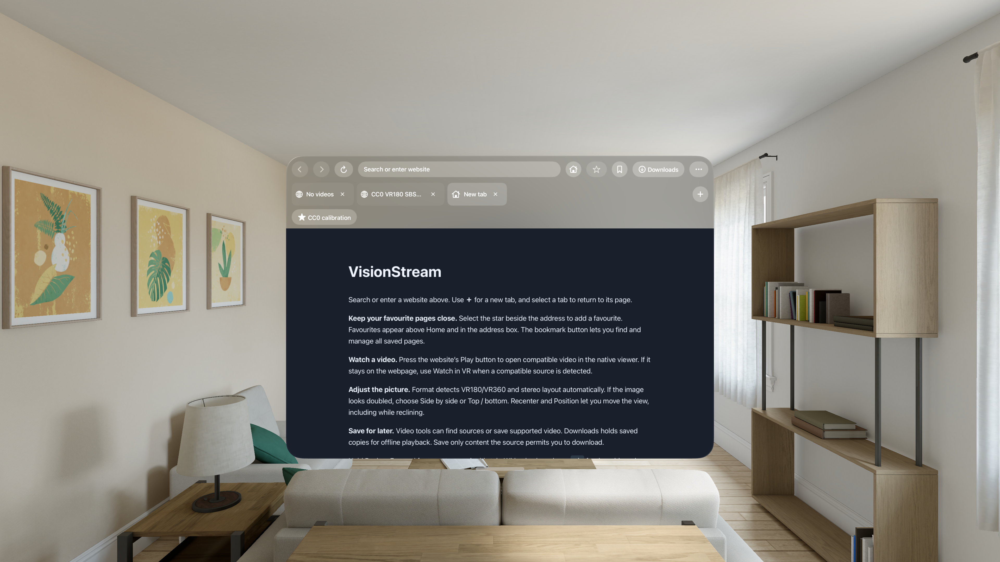
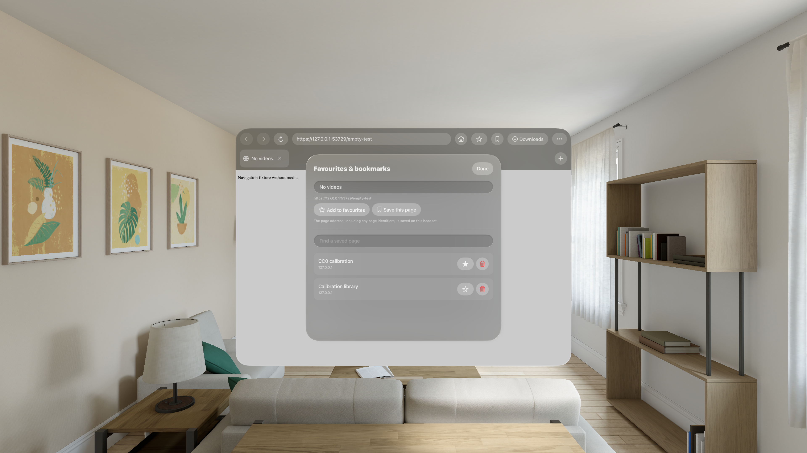
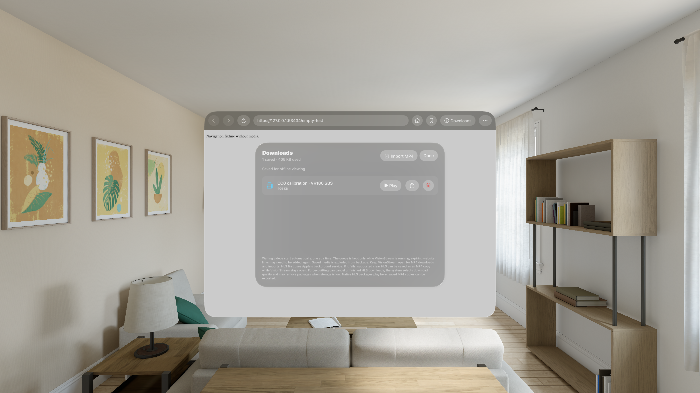
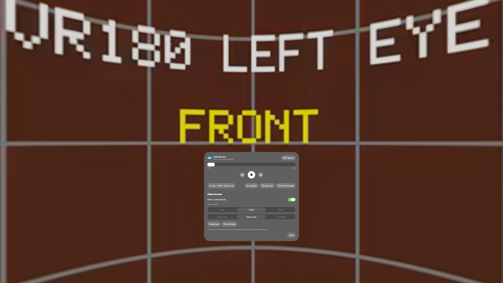

# VisionStream

Version 0.16.0 adds Original, Enhanced and Maximum Quality picture modes, paused-frame A/B, a developer pipeline overlay, higher-precision linear colour processing and full-width 8K mono textures within an explicit budget. See the [quality audit](VIDEO_QUALITY_AUDIT.md) and [benchmarks](VIDEO_QUALITY_BENCHMARKS.md). Simulator/native pixel tests pass; physical stereo/HDR/sustained-quality acceptance is still required.

A native web browser and immersive video player for Apple Vision Pro. Browse a website, start a compatible video and open it in a native Screen, VR180 or VR360 viewer.

**Current version: 0.18.0 · Early source release · visionOS 26+**

VisionStream has automated simulator coverage on visionOS 26 and 27 and has been installed on a physical Vision Pro. Physical-headset playback, comfort and broad website compatibility still need testing. It is not currently available through the App Store or TestFlight.

## Control comfort and canvas videos (0.18.0)

Controls now sit farther away by default, retain their apparent size and use a solid background over stereoscopic video. **Position → Controls distance** adjusts their depth from 2 to 5 metres. Physical comfort still needs checking on the headset.

Browser-local and canvas-backed videos can keep the video bar visible and offer **Find and watch in VR**. A supported unprotected HTTPS MP4/HLS source must still be resolved; a website’s VR icon alone does not make arbitrary WebXR content natively playable. See [use and limitations](Docs/INSTALLATION.md) and [verification](Docs/TESTING.md).

## Automatic highest-quality streaming (0.17.0)

With quality set to **Highest**, pressing the website’s Play button checks for higher-resolution sources automatically before opening VR. A slow lookup can finish while the original source plays and trigger an automatic upgrade in the same immersive view. Position, pause state and VR format are retained; switching may briefly buffer. Find streams remains available for manual inspection but is no longer required for this check.

**Adaptive** keeps connection-based selection within the current stream. Automatic discovery does not export browser credentials or bypass site controls. Source offers, expiry, account access and decoder support can limit the available quality; failed upgrades attempt to restore the previous stream. See [installation and use](Docs/INSTALLATION.md) and [verification](Docs/TESTING.md).

## Source quality and website controls (0.16.1)

Find streams now ranks usable entries by reported resolution, including entries labelled only “1440p”, and offers **Try highest resolution**. Highest in playback applies to the selected source’s playlist; another source on the website may offer more. Returning from VR keeps that page’s player inline so its settings remain usable. Choose Watch in VR manually or Video tools → Resume automatic VR on this page; navigation/reload also clears the hold.

Verification: 223 native tests pass with 12 optional skips on each of visionOS 26 and 27; seven mounted scenarios pass 72 checks per runtime. A user-selected 1440p source produced a confirmed 2880 × 1440 decoded header. This is not universal website compatibility or physical stereo/HDR acceptance. See [verification](Docs/TESTING.md).

## Features

- Up to eight tabs with independent pages and navigation history, plus persistent website sessions.
- One-touch favourites on Home and in address entry, searchable bookmarks, and Back/Forward history menus.
- Address or DuckDuckGo search entry with local saved-page suggestions; no remote typing suggestions.
- Automatic native opening after a recognised website Play action, with a manual Watch in VR fallback.
- Compatible MP4 and HLS streaming directly on Vision Pro; no Mac companion is needed during use.
- Equirectangular VR180/VR360 and flat-screen playback, with mono, side-by-side and top/bottom eye layouts.
- Automatic format detection using available metadata and repeated frame comparisons, with manual overrides for ambiguous sources.
- Highest-quality preference for supported published renditions; actual decoded resolution is shown. Some HLS sources remain adaptive.
- Playback, seeking, recentering and manual video tilt for positioning the picture while seated or reclined.
- Auto-hiding immersive controls: tap the video once to reveal them just below where you face.
- Supported MP4/HLS saves, a sequential save queue, offline playback and MP4 import/export.
- Local troubleshooting reports, optional full-link testing details and explicit playback checks; no automatic diagnostic uploads.

## Testing diagnostics

Open **Video tools → Playback details**, enable **Testing diagnostics · include full links**, then choose **Run playback checks**. After a failure, **Share report** exports current state and bounded retained session history. It includes full page/media/resource links, selected request/response headers, public timing/address metadata, cookie names/scope, webpage video readiness/events and native failure-resource evidence. Earlier redacted sessions cannot recover old links.

The explicit checks make a bounded normal source request and prepare a separate muted paused native item. They do not start playback or establish visible VR playback. Apple/WebKit may not expose every resource or response. Normal and testing modes keep foreground inspection separate from AVPlayer responses.

Public/App Store builds default testing mode off. Passwords, cookie values and authorization values stay excluded; ordinary signed stream links are included and may grant temporary access. Keep full reports private. Turning testing off redacts new exports; Delete diagnostic history removes retained details. [Details and private testing-build configuration](Docs/INSTALLATION.md).

## Screenshots

These are genuine visionOS Simulator captures using the bundled home page and original CC0 calibration clips. Browser/favourites images are from 0.13.0; the Downloads and immersive-controls images below remain from 0.12.0. They are not physical-headset photos or evidence of support for a third-party site.

## Install on your Vision Pro

There is currently **no universally installable signed download**. Each person builds and signs their own copy:

1. Download this repository using **Code → Download ZIP**, or clone it.
2. On an Apple silicon Mac, install Xcode with visionOS platform support. This version was built with Xcode 27.1; the deployment target is visionOS 26.0.
3. In Terminal, open the downloaded repository folder and run `python3 Scripts/prepare_embedded_extractor.py`. This fetches and checksum-verifies the pinned dependencies.
4. Open `VisionStream.xcodeproj`.
5. Select the VisionStream target, choose your own development team under Signing & Capabilities, and use a unique bundle identifier.
6. Pair your Vision Pro with Xcode/Device Hub and enable Developer Mode on the headset when prompted.
7. Select your Vision Pro as the run destination and press Run.

A free Apple Account can be used for personal device testing, subject to Apple's limits and seven-day provisioning. Rebuild/reinstall after the profile expires. TestFlight/App Store distribution requires the appropriate Apple Developer Program membership and remaining release work. See [installation details](Docs/INSTALLATION.md).

Use a network that allows the Mac and headset to communicate. Hotel/guest Wi-Fi can prevent development discovery or connections. A phone hotspot may be an alternative.

## Tabs and favourites

Use **+** for a new tab, select its title to switch and **×** to close it. Tabs share website logins. Background-tab media is suspended, but other website activity may continue. Tab lists remain in memory and are not restored after quitting; the existing startup preference still applies to the last active website. Closing the final tab creates a clean Home tab and clears remembered startup navigation.

Star a page beside the address to add/remove a favourite. Home and empty address entry show favourites; the bookmark button opens the searchable saved-page list. Existing bookmarks stay intact and can be starred. Hold Back/Forward to jump to a recent page in the current tab.

Keyboard: **⌘L** address, **⌘T** new tab, **⌘W** close tab, **⌘D** saved pages, **⌘⇧[ / ]** previous/next tab. Address entry labels search submissions to DuckDuckGo; invalid explicit URLs and URLs containing credentials do not fall back to search.

## First playback

Open a page and press its Play button. Compatible sources can open automatically in the native viewer. If that does not happen, use **Watch in VR** or **Find streams**. Automatic format detection is an estimate; change Format manually if needed. Projection (VR180/VR360) and eye layout (mono/side-by-side/top-bottom) are independent settings.

During playback the controls hide after five seconds. Tap the video once (look and pinch on Vision Pro) to show them below your current head-facing direction without moving the video. Tap again or choose **Hide controls** to hide them. They stay visible while paused or adjusting settings.

**Recenter** starts a three-second countdown: look toward the desired video centre and hold your pose. **Position → Video tilt** adjusts up/down by up to 90°. **Return to page** restores the browser. Reclining comfort and gaze/pinch interaction still need physical-device acceptance.

## Compatibility and limitations

- Supports compatible unprotected MP4 and HLS. It does not bypass DRM, login, subscriptions or website restrictions.
- Website-specific codecs, signed links, cookies and required request information can prevent native playback or saving, even when a webpage player works.
- Downloads support selected formats rather than every website. Some failed native HLS saves can recover through foreground remuxing; keep the app open for MP4 saves and that recovery. Waiting saves are in memory and clear when the app quits.
- Highest quality means the highest safely selectable supported published rendition, not guaranteed 4K/8K or a resolution absent from the source.
- Equirectangular projection is supported. Fisheye, cubemap, Apple Immersive Video/MV-HEVC, full HDR workflows, captions and alternate audio selection need more work.
- YouTube-specific support is deferred.
- Physical gaze/pinch delivery of the show/hide gesture still needs headset acceptance; the real scene collision surface and shared visibility actions are covered by simulator tests.

Read [test results](Docs/TESTING.md), [live-site observations](Docs/LIVE_SITE_TESTS.md), [production readiness](Docs/PRODUCTION_READINESS.md), [architecture](Docs/ARCHITECTURE.md) and [download limits](Docs/MEDIA_RUNTIME.md). Historical test references may point to private local evidence omitted from this public source package. They do not establish universal website support.

## Development

The project includes Swift 6/SwiftUI, WKWebView, AVFoundation, RealityKit and Metal sources, tests, and the pinned on-device runtime. The extractor packages are restored by the checksum-pinned setup script rather than republished in Git, because upstream extractor modules include hard-coded service keys that trigger GitHub push protection. There is no project-generation tool required to open it. See [automated testing](Docs/AUTOMATED_TESTING.md) and [runtime rebuilding](Docs/MEDIA_RUNTIME.md). Generated CC0 streaming fixtures are omitted; recreate them with `python3 Scripts/generate_fixtures.py` before the corresponding tests.

Original application code is **MIT** licensed. Third-party components retain their own licences, including the LGPL remux library; see [THIRD_PARTY_NOTICES.md](THIRD_PARTY_NOTICES.md). Forks and contributions are welcome. Anyone distributing a binary is responsible for signing, dependency obligations and their distribution requirements.

Private media, browsing reports, personal signing configuration and generated build caches are excluded from this repository.
