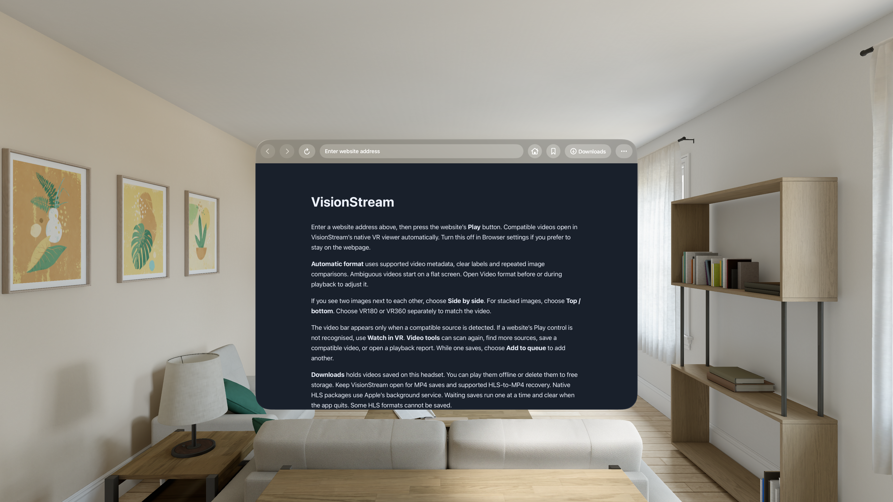
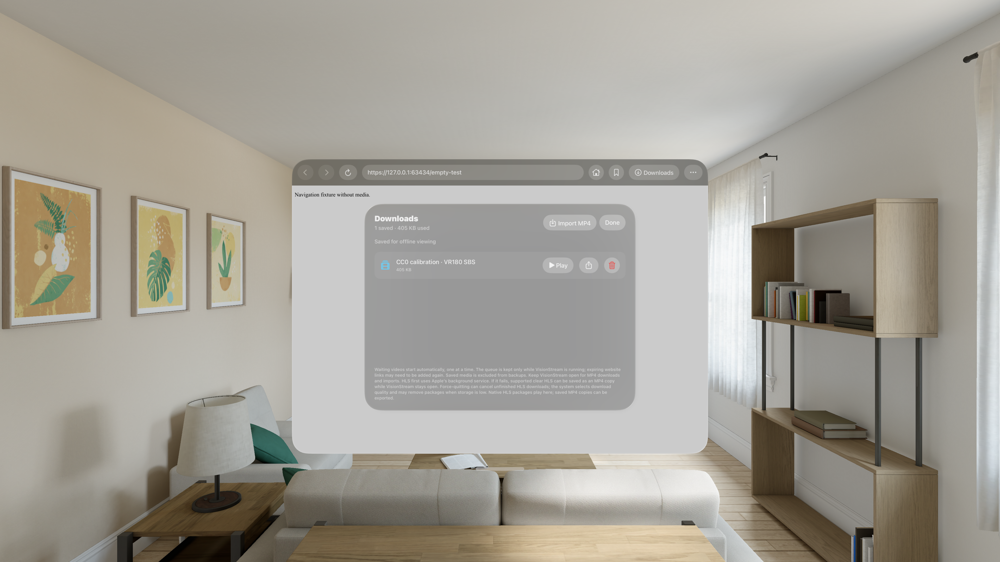
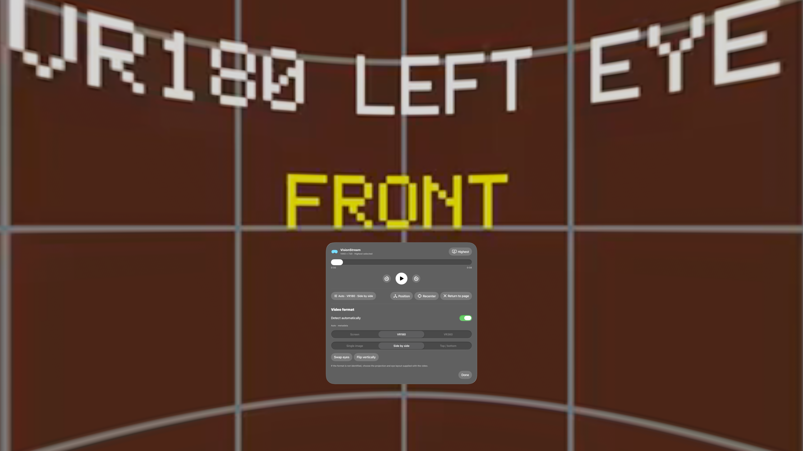

# VisionStream

A native web browser and immersive video player for Apple Vision Pro. Browse a website, start a compatible video and open it in a native Screen, VR180 or VR360 viewer.

**Current version: 0.12.0 · Early source release · visionOS 26+**

VisionStream has automated simulator coverage on visionOS 26 and 27 and has been installed on a physical Vision Pro. Physical-headset playback, comfort and broad website compatibility still need testing. It is not currently available through the App Store or TestFlight.

## Features

- WebKit browser with persistent website sessions, bookmarks and normal navigation.
- Automatic native opening after a recognised website Play action, with a manual Watch in VR fallback.
- Compatible MP4 and HLS streaming directly on Vision Pro; no Mac companion is needed during use.
- Equirectangular VR180/VR360 and flat-screen playback, with mono, side-by-side and top/bottom eye layouts.
- Automatic format detection using available metadata and repeated frame comparisons, with manual overrides for ambiguous sources.
- Highest-quality preference for supported published renditions; actual decoded resolution is shown. Some HLS sources remain adaptive.
- Playback, seeking, recentering and manual video tilt for positioning the picture while seated or reclined.
- Supported MP4/HLS saves, a sequential save queue, offline playback and MP4 import/export.
- Local troubleshooting reports; no automatic analytics or diagnostic uploads.

## Screenshots

These are genuine visionOS Simulator captures using the bundled home page and original CC0 calibration clips. They are not physical-headset photos or evidence of support for a third-party site.

## Install on your Vision Pro

There is currently **no universally installable signed download**. Each person builds and signs their own copy:

1. Download this repository using **Code → Download ZIP**, or clone it.
2. On an Apple silicon Mac, install Xcode with visionOS platform support. This version was built with Xcode 27.1; the deployment target is visionOS 26.0.
3. In Terminal, open the downloaded repository folder and run `python3 Scripts/prepare_embedded_extractor.py`. This fetches and checksum-verifies the pinned dependencies.
4. Open `VisionStream.xcodeproj`.
5. Select the VisionStream target, choose your own development team under Signing & Capabilities, and use a unique bundle identifier.
6. Pair your Vision Pro with Xcode/Device Hub and enable Developer Mode on the headset when prompted.
7. Select your Vision Pro as the run destination and press Run.

A free Apple Account can be used for personal device testing, subject to Apple's limits and seven-day provisioning. Rebuild/reinstall after the profile expires. TestFlight/App Store distribution requires the appropriate Apple Developer Program membership and remaining release work. See [installation details](Docs/INSTALLATION.md).

Use a network that allows the Mac and headset to communicate. Hotel/guest Wi-Fi can prevent development discovery or connections. A phone hotspot may be an alternative.

## First playback

Open a page and press its Play button. Compatible sources can open automatically in the native viewer. If that does not happen, use **Watch in VR** or **Find streams**. Automatic format detection is an estimate; change Format manually if needed. Projection (VR180/VR360) and eye layout (mono/side-by-side/top-bottom) are independent settings.

**Recenter** starts a three-second countdown: look toward the desired video centre and hold your pose. **Position → Video tilt** adjusts up/down by up to 90°. **Return to page** restores the browser. Reclining comfort and gaze/pinch interaction still need physical-device acceptance.

## Compatibility and limitations

- Supports compatible unprotected MP4 and HLS. It does not bypass DRM, login, subscriptions or website restrictions.
- Website-specific codecs, signed links, cookies and required request information can prevent native playback or saving, even when a webpage player works.
- Downloads support selected formats rather than every website. Some failed native HLS saves can recover through foreground remuxing; keep the app open for MP4 saves and that recovery. Waiting saves are in memory and clear when the app quits.
- Highest quality means the highest safely selectable supported published rendition, not guaranteed 4K/8K or a resolution absent from the source.
- Equirectangular projection is supported. Fisheye, cubemap, Apple Immersive Video/MV-HEVC, full HDR workflows, captions and alternate audio selection need more work.
- YouTube-specific support is deferred.
- Controls currently remain visible during immersive playback; auto-hide is not implemented.

Read [test results](Docs/TESTING.md), [live-site observations](Docs/LIVE_SITE_TESTS.md), [production readiness](Docs/PRODUCTION_READINESS.md), [architecture](Docs/ARCHITECTURE.md) and [download limits](Docs/MEDIA_RUNTIME.md). Historical test references may point to private local evidence omitted from this public source package. They do not establish universal website support.

## Development

The project includes Swift 6/SwiftUI, WKWebView, AVFoundation, RealityKit and Metal sources, tests, and the pinned on-device runtime. The extractor packages are restored by the checksum-pinned setup script rather than republished in Git, because upstream extractor modules include hard-coded service keys that trigger GitHub push protection. There is no project-generation tool required to open it. See [automated testing](Docs/AUTOMATED_TESTING.md) and [runtime rebuilding](Docs/MEDIA_RUNTIME.md). Generated CC0 streaming fixtures are omitted; recreate them with `python3 Scripts/generate_fixtures.py` before the corresponding tests.

Original application code is **MIT** licensed. Third-party components retain their own licences, including the LGPL remux library; see [THIRD_PARTY_NOTICES.md](THIRD_PARTY_NOTICES.md). Forks and contributions are welcome. Anyone distributing a binary is responsible for signing, dependency obligations and their distribution requirements.

Private media, browsing reports, personal signing configuration and generated build caches are excluded from this repository.
